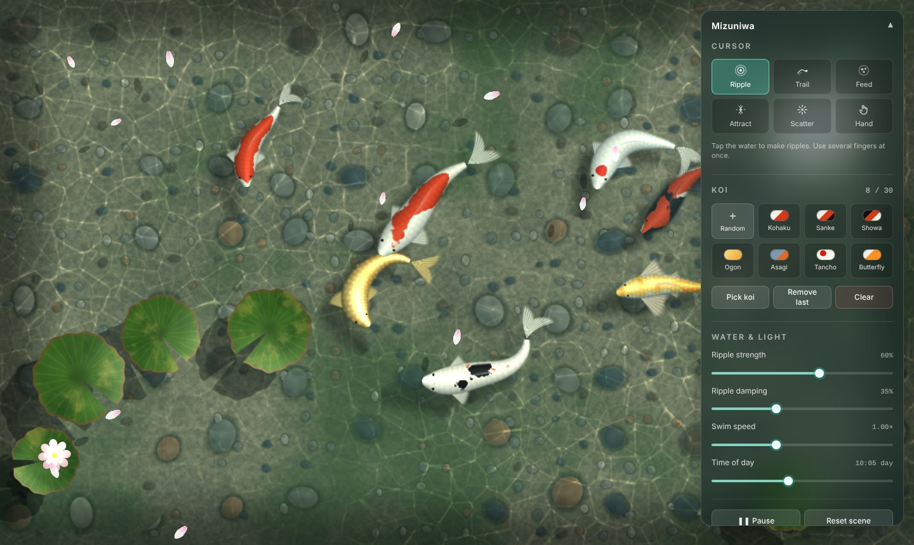

# Mizuniwa

_水庭 — "water garden"._ A koi pond you can touch.



An interactive, realistic koi pond in the browser. Koi with spine-driven swimming school around a pebble pond. You can poke the water and watch ripples refract the floor, feed the fish, scare them, or drag a finger through the water.

Built with **Next.js (App Router) + TypeScript**, **React Three Fiber / three.js** with custom GLSL shaders, **GSAP**, **Zustand** and **Tailwind CSS**.

## Getting started

Requires Node.js 20+ and pnpm, plus a browser with WebGL 2.

```bash
pnpm install
pnpm dev          # http://localhost:3000
```

| Script | What it does |
| --- | --- |
| `pnpm dev` | Development server |
| `pnpm build` | Production build (includes type-checking) |
| `pnpm start` | Serve the production build |
| `pnpm lint` | ESLint |
| `pnpm exec tsc --noEmit` | Type-check only |

## Controls

The control panel sits in the top-right corner. It starts collapsed on phones.

### Cursor modes

| Key | Mode | What it does |
| --- | --- | --- |
| `1` | **Ripple** | Tap or click to make ripples. Several fingers make several ripples at once. |
| `2` | **Trail** | Drag to draw a continuous wake. |
| `3` | **Feed** | Tap to drop pellets that slowly sink. Nearby koi swim over, rise or dive to them, and eat them. |
| `4` | **Attract** | Koi gently follow the cursor or finger and come up to the surface. |
| `5` | **Scatter** | Koi dart away from taps and fast movement, then calm down. |
| `6` | **Hand** | Your cursor is a finger in the water: it pushes water and nudges koi. |

Each mode has its own cursor, which is hidden on touch screens.

### Koi

- **Random** or a variety swatch adds a koi. The varieties are Kohaku, Sanke, Showa, Ogon, Asagi, Tancho and long-finned Butterfly koi.
- **Pick koi**: click a koi to remove it. This works while paused. `Esc` leaves pick mode.
- **Remove last** removes the newest koi; **Clear** empties the pond.
- The pond holds at most 30 koi (`fish.maxCount`).

### Water and light

Sliders control ripple strength, ripple damping, swim speed and time of day. Lighting moves smoothly from night through dawn and noon to dusk.

**Pause** (`P`) freezes the pond. **Reset scene** restores the default fish and settings.

## Architecture

```
src/
  app/            layout + page (server components)
  config/         pond.config.ts – every tunable constant
  store/          Zustand store: fish list, mode, parameters, pause, quality
  scene/          PondCanvas (R3F canvas, adaptive quality), PondEngine, lighting, shared uniforms
  water/          RippleSimulation (GPU), PondFloor, WaterSurface, FloatingElements
  fish/           Koi, FishSystem (behaviour), FoodSystem, spine solver, geometry, varieties
  interaction/    InputController (pointers), ModeController (modes), CustomCursor
  shaders/        GLSL as TypeScript strings
  ui/             Control panel and its pieces
  lib/            math helpers, TweenGroup, reduced-motion hook
```

### Rendering pipeline

`PondCanvas` mounts a single imperative `PondEngine` and drives it from R3F's frame loop. The loop runs at priority 1, so R3F's automatic render is replaced. React never re-renders per frame. The UI talks to the engine only through the Zustand store.

Each frame:

1. **Input**: pointer events (mouse, pen, any number of touches) become ripples, food drops and steering forces for the current mode.
2. **Fish and food**: koi steer (wander, schooling, edge avoidance, mode and food influences), move, and rebuild their spines. Shallow koi push faint wakes into the water.
3. **Ripple simulation**: queued drops are stamped into a half-float height field, then a fixed-timestep wave equation runs on ping-pong render targets. The texture stores height, velocity and the surface gradient.
4. **Underwater pass**: floor (pebbles, silt, algae, caustics), lily-pad shadows, koi shadows, food and koi are drawn into an off-screen target.
5. **Water composite**: a full-screen shader refracts the underwater image through the ripple normals and adds Fresnel sky reflection and a localised sun glint. Lily pads, blossoms and petals are drawn on top, bobbing on the same height field.

### Koi

Each koi is **one draw call**. The body, tail, pectoral, pelvic and dorsal fins are parametric grids in one geometry. The vertex shader bends them along a 14-joint spine using Catmull-Rom interpolation. On the CPU, the spine is a follow-the-leader chain with limited joint bend, plus a travelling wave whose amplitude grows towards the tail. Its frequency rises with swim speed. The tail fin lags the wave and swings outward on turns. The pectoral fins spread and row when slow, tuck in when fast and brake on the inside of turns.

Patterns are procedural (noise plates, scale arcs, the Tancho crown, the Asagi net), so no textures are needed. Depth is faked with scale, edge blur and fading into the water colour. Each koi casts a soft floor shadow offset along the sun direction, which gets softer and fainter the shallower the koi swims.

### How GSAP and WebGL share the work

| GSAP (time-based transitions) | WebGL / frame loop (every frame) |
| --- | --- |
| Koi rising in on spawn, diving away on removal | Wave simulation and refraction |
| Idle drifts (speed in and out) | Boids steering and spine physics |
| Scatter panic, then calming down | Shader uniforms for koi, floor and floaters |
| Pellets sinking, resting and fading | Food seeking and eating |
| Time-of-day lighting transitions | Floater drift, shoves and collisions |
| Panel open/close, custom cursor follow, morph and pulse | |

GSAP only animates plain values, such as `koi.behaviour.panic`, and the frame loop reads them. Simulation tweens live in a `TweenGroup` (a `gsap.context`) that pauses with the pond and is killed on unmount.

## Tuning

Every constant is in [`src/config/pond.config.ts`](src/config/pond.config.ts).

| Section | Notable keys |
| --- | --- |
| `water` | `stepsPerSecondAt256` (wave speed), `dampingMin/Max` (slider range), `clickRadius/Strength`, `trail*`, `hand*`, `normalStrength`, `refractionDepth`, `specular*` |
| `floor` | `causticStrength`, `causticScale`, `causticSpeed`, `rippleCausticGain`, `pebbleScale` |
| `fish` | `maxCount`, `lengthMin/Max`, `cruiseSpeed`, `beat*` (tail beat), `maxJointBend`, `boids.*`, `wander.*`, `idle.*`, `depth.*`, `shadow.*`, `wake.*` |
| `interaction` | attract, scatter and hand radii and strengths |
| `food` | pellets per click, sink time, sense and eat radius |
| `floaters` | number of lily pads and petals, bobbing and shove strength |
| `quality` | quality levels, FPS bounds, starting level for desktop and mobile |
| `reducedMotion` | scaling applied when the OS asks for reduced motion |

Some useful recipes:

- **Calmer water**: lower `water.clickStrength`, or raise `water.dampingMax`.
- **Faster ripples**: raise `water.stepsPerSecondAt256`. Wave speed stays the same at every simulation resolution.
- **Tighter schools**: raise `fish.boids.cohesion` and `alignment`, or lower `separation`.
- **More dramatic caustics**: raise `floor.causticStrength` and `rippleCausticGain`.

## Performance

Adaptive quality uses drei's `PerformanceMonitor`. It steps through four quality levels, each setting the DPR cap, the ripple simulation resolution and the underwater render scale, based on the measured frame rate. After a few swings up and down it locks, so quality stops flickering. Touch devices start at Medium instead of Ultra. The panel shows the current FPS and quality level.

Trade-offs and their defaults:

- **Depth blur**: done by softening edges and fading colour, not with a depth-of-field pass, which would cost too much on mobile.
- **Fish rendering**: one draw call per koi, plus one for its shadow, with up to 30 koi. Instancing would be cheaper, but per-fish patterns and fin parameters are simpler as per-material uniforms.
- **Simulation resolution**: 128 to 256 texels on the short side. Dropping the resolution resets the current ripples, which is barely noticeable.
- **Caustics**: computed per floor pixel from animated Voronoi edges, plus true focusing from the ripple height field's Laplacian. There is no extra photon pass.

## Accessibility

- `prefers-reduced-motion`:
  - ripples are 40% as strong
  - koi swim slower and leave no wakes
  - caustics move at 30% speed
  - panel and cursor animations are instant
- Panel controls are real buttons, radios and range inputs with labels and live regions. The whole panel is keyboard reachable, and keys `1`–`6`, `P` and `Esc` work too.

## Cleanup

On unmount the engine removes its listeners and store subscriptions, and kills all GSAP tweens. It also disposes every render target, geometry and material. React StrictMode's mount, unmount and remount cycle in development exercises this path on every load.
